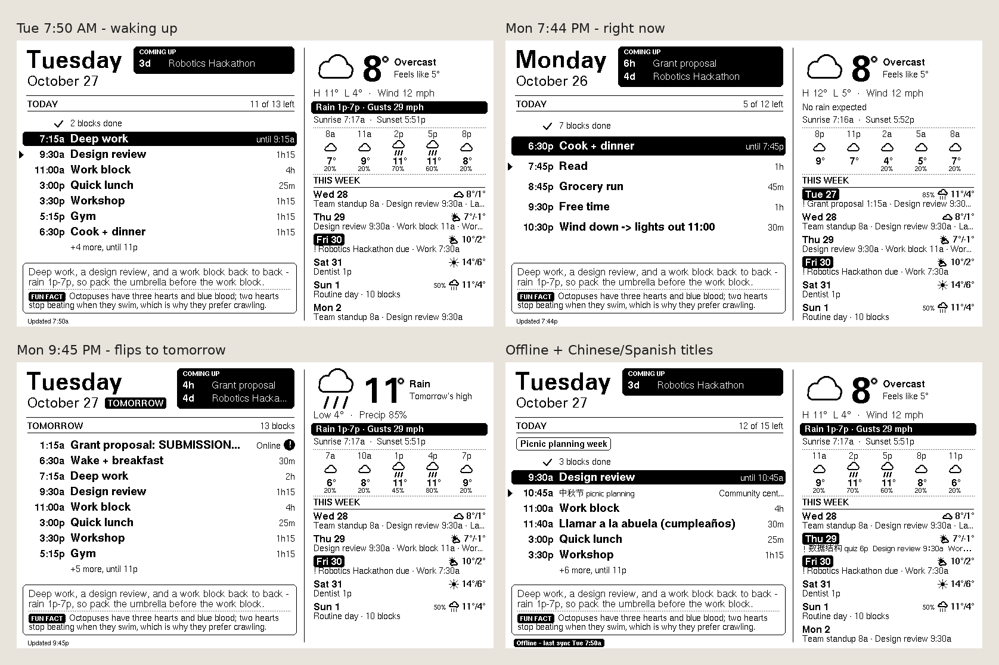
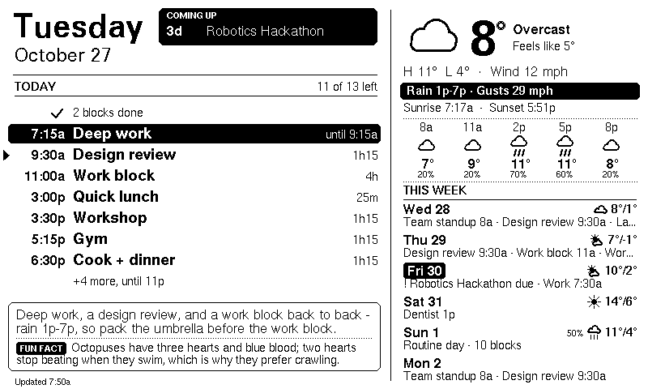
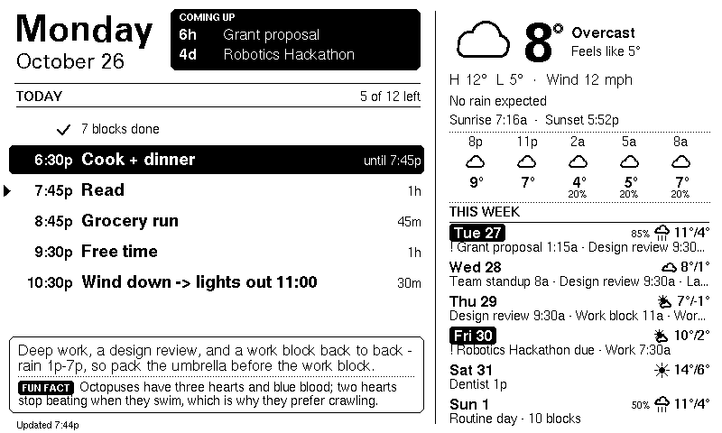
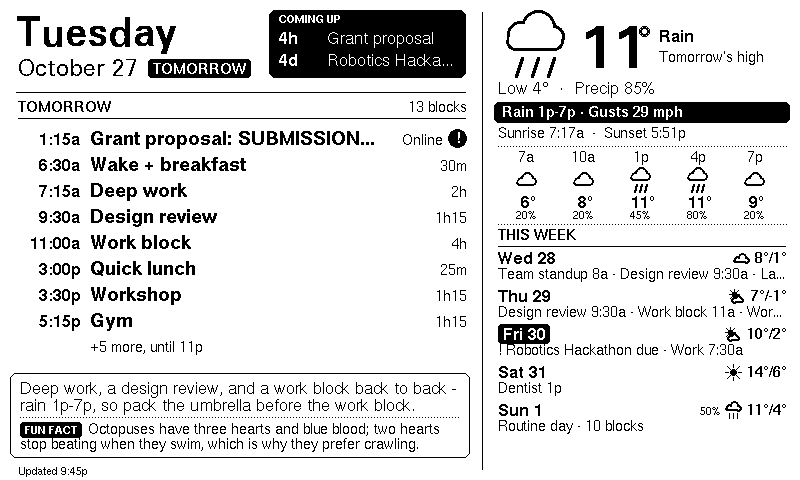
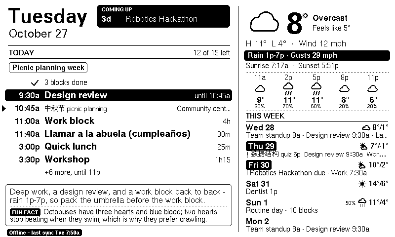

# Bedside e-ink dashboard

A Waveshare 7.5" e-paper panel and an ESP32 that show today's agenda, the weather that changes your plans, and a short daily brief. It wakes twice an hour, draws, and goes back to sleep.



## Features

- Today's agenda, with finished blocks collapsed, the current block marked, and the next one called out.
- A **coming up** countdown for deadlines and other key events.
- Weather that shows up when it matters: rain or snow windows, strong gusts, and a feels-like warning.
- A week view of anchor events, so the daily routine does not fill the panel.
- A Gemini daily brief and a fun fact. No API key, and the brief box hides itself.
- Partial refresh (no black-and-white flash), with a full refresh on a schedule.
- Deep sleep between wakes.
- Over-the-air firmware updates.
- Spanish accents and GB2312 Chinese. Emoji in titles are stripped.

## Hardware

| Part | Notes |
|---|---|
| [Waveshare 7.5" e-Paper V2](https://www.waveshare.com/wiki/7.5inch_e-Paper_HAT) (800×480, black and white) | The panel. |
| [Waveshare e-Paper ESP32 Driver Board](https://www.waveshare.com/wiki/E-Paper_ESP32_Driver_Board) | ESP32 plus the panel connector. |
| Micro-USB cable | Power and the first upload. Any 5 V USB supply works after that. |
| Frame | Optional. |

1. On the driver board set **Display Config = B** (0.47 Ω — the setting for the 7.5" panel) and the other switch to **ON** (it must be ON to upload).
2. Open the connector latch, slide the panel's ribbon fully in, close the latch. If the panel never changes at all, check the ribbon orientation against the photo on Waveshare's wiki (e-Paper ESP32 Driver Board page).
3. Power from any USB 5 V supply via micro-USB.

## How it works

Google Calendar, Open-Meteo, and Gemini stay on the Apps Script side. The board only fetches a small JSON document, draws it, and sleeps.

```
ESP32 wakes ──WiFi──► Apps Script web app (runs as you) ──► Google Calendar
   │                          ├──────────────────────────► Open-Meteo (weather, no key)
   │                          └──────────────────────────► Gemini (brief + fun fact, cached)
   │◄──────── ~7 KB JSON ─────┘
   └─ draws (partial refresh, no flash), saves a copy to flash, deep-sleeps until the next :00 / :30
```

The backend does the heavy lifting (recurring events, time zones, emoji stripping, rain windows, deadline detection), so the firmware only draws.

- Refreshes every 30 min, sleeps 00:30–05:30, so it's fresh before a 6:30 wake-up.
- After **9:30 PM** the agenda flips to **tomorrow**.
- Finished blocks collapse into "✓ N blocks done"; the current block is inverted; ▶ marks the next one.
- **Coming up** matches titles with *deadline / due / submission / exam / quiz / midterm / interview / presentation* in the next 14 days, and counts down in hours inside a day.
- **This week** shows anchors only: one-off events, all-day events, deadlines, the color ids in `ANCHOR_COLORS`, and titles matching `ANCHOR_TITLES` (by default a title that starts with "Work"). Days with a deadline get an inverted label.
- The weather note appears for rain or snow during 7a–10p, gusts ≥ 25 mph, or feels-like ≤ 0°C.
- The brief is one or two sentences about the day (tomorrow after 9:30 PM) plus a fun fact that changes daily and does not repeat for 20 days. An hourly trigger asks Gemini ahead of time, and only when the day's calendar or forecast changed, so the board's request never waits on it. No API key, or Gemini down, and the box disappears.
- Most refreshes are partial (~1.6 s, no flash). A full refresh clears ghosting every 8 wakes (~4 h), on the first refresh of the morning, and after any reset.
- WiFi reconnects straight to the last access point and channel (no scan). NTP runs every 6 h; between those, the backend's timestamp corrects clock drift. Watch `awake N ms` on the serial monitor.
- No WiFi? It redraws from the last good copy with an **Offline** tag and retries in 10 min.
- Press **RST** on the board to force a full refresh.

```
┌──────────────── left: TODAY ────────────────┬──────── right ─────────┐
│ Tuesday            ┌ COMING UP ───────────┐  │ ☁  8°  Overcast         │
│ October 27         │ 3d  Robotics Hackathon│  │ H 11° L 4° · Wind 12   │
│─────────────────────└──────────────────────┘  │ [Rain 1p-7p · Gusts 29] │
│ TODAY                         11 of 13 left  │ 8a  11a  2p  5p  8p     │
│   ✓ 2 blocks done                            │─────────────────────────│
│ ███ 7:15a Deep work              until 9:15 │ THIS WEEK               │
│ ▶  9:30a Design review              1h15    │ Wed 28   ☁  8°/1°       │
│   11:00a Work block                    4h    │  Standup 8a · Review    │
│   ...                                        │ [Fri 30] ! Robotics due │
│ ╭ Deep work, a design review, and a work   ╮ │                         │
│ │ block — rain 1p-7p, pack the umbrella.   │ │                         │
│ ╰ [FUN FACT] Octopuses have three hearts...╯ │                         │
└──────────────────────────────────────────────┴─────────────────────────┘
```

## Setup

### 1. Backend (Google Apps Script)

1. Go to [script.google.com](https://script.google.com) while signed in to your Google account → *New project*.
2. Paste `backend/Code.gs` into `Code.gs`.
3. *Project Settings* → tick **Show "appsscript.json"** → replace its contents with `backend/appsscript.json`.
4. *Project Settings → Script properties → Add*: `DASH_TOKEN` = a long random string (for example 32 random letters and digits). It stays in Google, not in the code, so it never lands in git.
5. Run `testPayload` once from the editor → approve the permissions (read-only calendar + external requests) → check the log shows your events.
6. *Deploy → New deployment → Web app*: **Execute as: Me**, **Who has access: Anyone** → Deploy. Copy the `/exec` URL.
7. Test in a browser: `<exec URL>?token=<your token>` should return JSON starting with `{"ok":true`.

**Gemini (optional):** get a free API key at [aistudio.google.com](https://aistudio.google.com) → *Get API key*. In Apps Script, *Project Settings → Script properties → Add*: `GEMINI_API_KEY` = your key. Run `testAi` from the editor to check the log shows a brief and a fact. The key stays in Google; it is never on the board. Then run `installTriggers` once (approve the new "run on a schedule" permission). That sets up the hourly `refreshAi` job.

When you edit `Code.gs` later: *Deploy → Manage deployments → pencil → Version: New version*, so the URL stays the same.

### 2. Firmware (Arduino IDE 2.x)

1. Boards Manager: install **esp32 by Espressif Systems** (3.3.x).
2. Library Manager: install **GxEPD2**, **Adafruit GFX Library** (say yes to Adafruit BusIO), **U8g2_for_Adafruit_GFX**, **ArduinoJson** (7.x).
3. In `firmware/eink_dashboard/`, copy `secrets.example.h` to `secrets.h` and fill in the WiFi name, password, and `DASH_URL` (the exec URL + `?token=<your DASH_TOKEN>`). `secrets.h` is gitignored. Everything else is in `config.h`.
4. *Tools*: Board **ESP32 Dev Module**, Partition Scheme **Minimal SPIFFS (1.9MB APP with OTA/128KB SPIFFS)**. That scheme is what over-the-air updates need. The first upload after switching wipes the saved copy, which is fine.
5. Upload. Open Serial Monitor at 115200 to watch `[wifi] [ntp] [http] [sleep]` lines.

Compiled clean against esp32 core 3.3.12, GxEPD2 1.6.9, ArduinoJson 7.4.2: 1.55 MB flash (of 1.9 MB), 81 KB static RAM, plus a 48 KB frame on the heap while drawing.

### 3. Updates over WiFi (OTA)

After the first USB upload with the partition scheme above, later builds can go over WiFi:

1. Bump `FW_VERSION` at the top of `eink_dashboard.ino` (for example 2 → 3).
2. *Sketch → Export Compiled Binary*. Take `eink_dashboard.ino.bin` from the `build/` folder.
3. Put it somewhere reachable over HTTPS. A GitHub release asset works. Copy that link.
4. In `Code.gs` set `FW_VERSION: 3` and `FW_URL: '<that link>'`, then redeploy (*New version*).

On its next wake the board sees the newer version, downloads it, and reboots into it (full refresh). If a build fails to install three times in a row it stops trying that version. Test a build over USB first. A build that crashes on boot needs USB to recover.

## Configuration

`Code.gs` → `CONFIG`:

| Key | What it does |
|---|---|
| `CALENDARS` | Calendar ids to read. `primary` is the account that owns the script. |
| `TZ` | IANA time zone, for example `America/Chicago`. |
| `LAT`, `LON` | Weather location. The sample is downtown Chicago. |
| `CELSIUS` | `true` = °C, `false` = °F. |
| `METRIC` | `true` = km/h wind, `false` = mph. |
| `H24` | 24-hour clock in weather notes. |
| `DAYS` | How many days the payload includes (today + the rest). |
| `KEY_LOOKAHEAD_DAYS` | How far ahead **coming up** looks. |
| `ANCHOR_COLORS` | Google Calendar color ids that always show in the week view. |
| `ANCHOR_TITLES` | Title pattern that also counts as an anchor. Default: starts with "Work". |
| `KEY_PATTERN` | Titles that become deadlines (countdown box). |
| `RAIN_POP` | Precipitation probability that counts as rain. |
| `GUST_WARN` | Gust speed that earns a note. The default is mph; use about 40 if `METRIC` is true. |
| `COLD_FEELS` | Feels-like temperature that earns a note, in the `CELSIUS` unit. |
| `WAKING_HOURS` | Hours the weather note cares about. |
| `AI_MODEL`, `AI_FACT_HISTORY` | Gemini model, and how many past facts to avoid repeating. |
| `TOMORROW_FROM_MIN` | When the brief switches to tomorrow. Keep it equal to `TOMORROW_VIEW_FROM`. |
| `FW_VERSION`, `FW_URL` | OTA. `0` and `''` mean no update. |

`firmware/eink_dashboard/config.h`:

| Define | What it does |
|---|---|
| `TZ_POSIX` | POSIX time zone. Must match `CONFIG.TZ`, including daylight saving. |
| `TIME_24H` | 24-hour clock on the panel. |
| `REFRESH_MINUTES` | Wake interval. 30 means :00 and :30. |
| `QUIET_FROM_MIN`, `QUIET_UNTIL_MIN` | No refreshes in this window (default 00:30–05:30). |
| `TOMORROW_VIEW_FROM` | When the agenda flips to tomorrow (default 9:30 PM). |
| `NTP_RESYNC_HOURS` | How often to ask NTP. |
| `FULL_REFRESH_EVERY` | Full (flashing) refresh every N wakes. 0 = always full. |
| `OTA_ENABLED` | `1` to allow OTA downloads. |
| `PANEL_DRIVER` | `GxEPD2_750_T7`, or `GxEPD2_750_GDEY075T7` if the image is faint or blotchy. |

WiFi name, password, and `DASH_URL` live in `secrets.h` (copy `secrets.example.h`). For a WPA2-Enterprise network, set `WIFI_ENTERPRISE` to 1 and fill in the identity.

Other knobs:

| What | Where |
|---|---|
| Tone and length of the brief, and what kind of facts | `Code.gs` → prompt in `buildAi_` |
| Drop the Chinese font (saves about 250 KB of flash) | `#define DASH_CJK 0` at the top of `render.cpp` |

**Traveling, or a different time zone:** in `Code.gs` set `TZ` (for example `America/Denver`) and `LAT` / `LON` to where you are. Set `METRIC: true` if you want km/h. In `config.h` set `TZ_POSIX` to the matching POSIX string (for Denver, `MST7MDT,M3.2.0,M11.1.0`). Redeploy and upload again.

## Troubleshooting

| Screen / serial says | Fix |
|---|---|
| "Can't connect to WiFi" | The ESP32 is 2.4 GHz only. Check the SSID and password. Some networks need `WIFI_ENTERPRISE` or device registration. The serial line prints the MAC address. |
| "Can't load the calendar — bad token" | The `DASH_TOKEN` script property does not match `token=` in `DASH_URL`, or the property is not set. |
| HTTP 401/403, or an HTML page | Deployment access is not **Anyone**, or the URL is `/dev` instead of `/exec`. |
| `connection refused` / `-1` | Usually transient; it retries in 10 min. If it persists, re-check the URL. |
| Image faint, blotchy, partly drawn | Flip the Display Config switch, or try the `GxEPD2_750_GDEY075T7` driver. |
| Leftover gray between full refreshes | Lower `FULL_REFRESH_EVERY` in `config.h` (for example 4), or 0 for always-full. |
| Times off by an hour | `TZ_POSIX` in `config.h` does not match `TZ` in `Code.gs`. |

## Development

Regenerate the sample week, then run the backend against it. The three times below are the ones the preview pictures use (evening, morning, bedtime):

```bash
python3 tools/make_fixture.py
node tools/test_backend.js tools/fixture.json 2026-10-27T12:50:00Z out.json
node tools/test_backend.js tools/fixture.json 2026-10-27T00:44:00Z out.json
node tools/test_backend.js tools/fixture.json 2026-10-27T02:45:00Z out.json
```

Schedule unit test (no hardware):

```bash
g++ -std=c++17 -I firmware/eink_dashboard tools/test_schedule.cpp && ./a.out
```

Preview pictures (needs a host g++, Python 3 with Pillow, and Node). `LIBS` is a directory that contains `Adafruit-GFX-Library` (sources in `src/`), `U8g2_for_Adafruit_GFX`, and `ArduinoJson`:

```bash
LIBS=/path/to/libs tools/preview/build_and_render.sh
```

PNGs land in `tools/preview/out/`, which is gitignored. The pictures in `docs/` are copies of those renders.

### Screenshots

Morning, just after wake-up. The agenda is today.



Evening. Finished blocks are collapsed and the current block is marked.



After 9:30 PM the panel flips to tomorrow.



Offline, with Chinese and accented titles, from the last good copy.



## Security

Never commit `secrets.h`. The `DASH_TOKEN` script property is the only thing standing between the public web app URL and your calendar, so make it long and random. The Gemini key stays in Apps Script script properties too. Neither belongs in the firmware or in git.

## License

[MIT](LICENSE). Copyright (c) 2026 FortakenJay.
